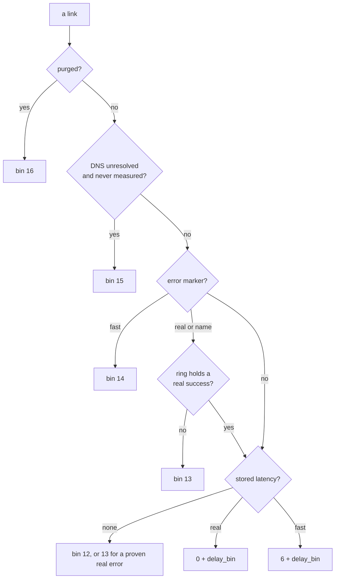
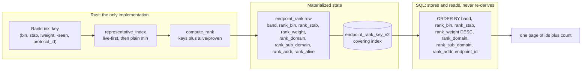

# The ordering law

This document owns one question: how the Profiles tab decides which endpoint is
"best", how that decision is computed once in Rust and stored, and how the page
reads it. It covers the two keys, the delay bin, the stability bin, the static
config weight, the derivation pipeline, the view bands, the resolution and purge
sinks, search, the measurements behind the design, and what was retired. It does
not own the table and index definitions (see [database.md](database.md)), the
hand-written SQL inventory (see
[database-manual-sql.md](database-manual-sql.md)), or the TUI screens (see
[../guides/tui-manual.md](../guides/tui-manual.md)).

Authority in code: `crates/leas-db/src/endpoint_rank.rs` (`RankLink::key`,
`representative_index`, `compute_rank`, `STAB_VERSION`),
`crates/leas-proto/src/proto_spec/weight.rs` (the static weight, `WEIGHT_VERSION`),
`crates/leas-db/src/profiles_query.rs` (the SQL order), and
`crates/leas-db/src/models_toasty.rs` (`EndpointRow`). Decisions: `AGENTS.md`
15 and 16; ADRs [0003](../aegis/adr/0003-stored-profile-ordering-keys.md),
[0006](../aegis/adr/0006-purge-evidence.md),
[0010](../aegis/adr/0010-materialized-active-band.md),
[0011](../aegis/adr/0011-db-rewamp-identity-and-column-retirement.md).

## 1. What the law answers

One question, asked of every endpoint: if a user activates this endpoint, which
of its links will it dial, and how good is that link versus every other
endpoint's?

That is two nested questions, and the code answers them with two different keys.
The separation is the whole design:

| | question | key | scope |
| --- | --- | --- | --- |
| link key | which of this endpoint's links represents it? | `(bin, stab_bin, !weight, -seen, protocol_id)` | within one endpoint |
| endpoint key | where does the endpoint sit on the page? | `(band, bin, stab_bin, !weight, domain, sub_domain, addr, endpoint_id)` | across the feed |

The endpoint key describes the representative link's order terms. The
representative is chosen live-first: a link whose newest ring sample succeeded
represents before a recently failed sibling (§8.2). Whether the endpoint is in
the `Successful` scope is a separate stored fact (`rank_proven`, §6.1), so a
proven endpoint can carry bin 12 or 13 when an untested or failing sibling is
its representative; membership cannot ride the key.

The link key selects, the endpoint key orders. The link key's recency term
(`-seen`) is deliberately absent from the endpoint key: recency decides which
link represents an endpoint, not where the endpoint ranks.

Both are ascending tuples compared by a single `.min()` or `ORDER BY`. There is
no `Reverse`, no wrapper type, no second comparator: a fork in the comparison is
what makes orderings drift.

### 1.1 The link key

```
(bin, stab_bin, u64::MAX - weight, -seen, protocol_id)
```

- `bin`: the coarse measurement band (§2). Lower is better.
- `stab_bin`: the recent real-probe success rate, coarsened to `0..7` (§2.1).
  Lower is better; `4` is neutral (warm-up or never sampled). It sits before the
  weight: inside one delay bin the link that has proved reliable leads the flaky
  one, whatever stack each runs.
- `u64::MAX - weight`: the static config weight (§3), negated so "higher weight
  is better" rides an ascending tuple. The same idiom as `-seen`: one plain
  ascending key, no `Reverse`.
- `-seen`: the newest link wins a tie.
- `protocol_id`: a stable final tiebreak, so the order is total.

### 1.2 The endpoint key

```
(band, bin, stab_bin, u64::MAX - weight, domain, sub_domain, addr, endpoint_id)
```

The first four terms are the representative link's `(bin, stab_bin, weight)`,
that is the `.min()` of §1.1 with `-seen` and `protocol_id` dropped. The tail is
the address tiebreak: the endpoint's registrable domain, its sub-domain labels,
and, for an IP host, its packed literal. Two equally ranked endpoints therefore
order deterministically and alphabetically by host.

`band` leads because it is the one term the page filters on (§5). With it first,
an Active page is a covering seek and the All view a covering scan, both in index
order and neither with a temp b-tree.

## 2. The bin: measurement, coarsened

The `bin` replaces the old `(tier, latency)` pair. Raw latency cannot lead the
endpoint key: it is an `i32` with `i32::MAX` sentinels, and a single noisy probe
would reorder the feed. Bucketing keeps the intent (did something work, and
roughly how fast) while making the key a small dense integer.

| bin | meaning | bin | meaning |
| --- | --- | --- | --- |
| 0 | real, < 50 ms | 6 to 11 | fast success, the same six delays |
| 1 | real, < 100 ms | 12 | untested (no latency) |
| 2 | real, < 250 ms | 13 | real or name error, no real success in the ring |
| 3 | real, < 500 ms | 14 | fast error marker |
| 4 | real, < 1000 ms | 15 | DNS host, unresolved and never measured |
| 5 | real, >= 1000 ms | 16 | purged |

`delay_bin(d)` is `<50` 0, `<100` 1, `<250` 2, `<500` 3, `<1000` 4, else 5.



Two properties the numbering encodes, both load-bearing:

- A real measurement outranks a fast one of any delay. The real bands are `0..5`
  and the fast bands `6..11`, so no fast result can reach a real band. A fast
  probe is a transport handshake; a real probe dials through the tunnel and
  fetches. They are not the same evidence.
- DNS unresolved (15) sits below every measured band and above nothing else. It
  is an endpoint-level fact, not a link fact: the unmeasured links of an
  unresolved endpoint collapse to it (§6). A measured link keeps its own band,
  because the probe dials the name and the OS resolves it, so an empty address
  set is not evidence that the name fails (2026-10-22).

Bins 13 and 14 fold the persisted failure marker; 16 is the purge sink (§6).

### 2.1 The stability bin

`stab_bin` is a second, independent `0..7` band: the link's recent real-probe
success rate, from a ring of the last `STAB_WINDOW = 16` real outcomes
(`profile_stats.stab_mask` and `stab_len`; one real sample per link per batch
run, with `STAB_WARMUP = 4` samples before the ratio is trusted).

| `stab_bin` | success rate | `stab_bin` | success rate |
| --- | --- | --- | --- |
| 0 | >= 95% | 4 | >= 45% (neutral) |
| 1 | >= 85% | 5 | >= 30% |
| 2 | >= 75% | 6 | >= 15% |
| 3 | >= 60% | 7 | < 15% |

`STAB_NEUTRAL = 4` has three uses that must not drift: the warm-up and empty
return, the `rank_stab` column default, and the panel's "no data" rendering.

What counts as a sample is narrow. A real probe that ran appends its outcome. A
hard-fast retirement in a real-capable batch appends a failure, because the
verdict retired the probe it prevented. A fast success never appends, and a
fast-only batch never appends. A dedup-sibling retire, a stop-retire, a
queue-full refusal and an `UNTESTABLE_PREFIX` refusal never append, because none
is a probe of that link. One function computes it (`endpoint_rank::stab_bin`),
and both the rank refresh and the panel read it; SQL never re-derives it.

## 3. The static config weight

The weight answers the one question measurement cannot: among links nothing has
probed yet, which stack should be tried first? It is a compiled taste table, not
a measurement (`proto_spec/weight.rs`, `WEIGHT_VERSION` 1).

Four coarse bands, in precedence order, packed into `ConfigWeight`
(`#[repr(C)]` with `Ord` derived from field order):

| band | axis | higher means | values (out of 10) |
| --- | --- | --- | --- |
| `security` | which security | stronger prior | reality 10, tls 6, none 2 |
| `mimicry` | DPI detectability of the (transport, security) pair | harder to fingerprint | tcp+reality 10 down to kcp 2 |
| `sec_cost` | security-layer cost, inverted | cheaper handshake | none 10, tls 6, reality 3 |
| `transport_cost` | transport cost, inverted | cheaper transport | tcp 10 down to kcp 3 |

Three design rules, each following from "this is a prior, not a model":

- **Coarse bands (`0..=10`).** Declaration order is precedence, so `security`
  decides unless two stacks tie on it exactly. With fine-grained values the lower
  three bands would only ever be read on exact ties, and the weight would
  degenerate to "pick the best security". Coarse bands are a constraint.
- **Exhaustive lookups, no `_` arm.** A new `TransportType` or `SecurityType`
  variant is a compile error here, never a silent zero that sinks every row of
  that shape to the bottom of the page. `mimicry_score` matches on the pair, so a
  new variant on either axis fails to compile.
- **Versioned.** The tables are code, so an edit silently invalidates every
  stored weight. The database compares `KEY_INPUTS_VERSION` at open and
  recomputes all keys on a mismatch (`rank_weight_meta`).

Only the `mimicry` band moves on `sni` and `fp`: a client-hello fingerprint adds
one to a secured stack, and a TLS stack with no SNI loses one. `security` is a
function of `SecurityType` alone. Protocol kind is not a dimension (VLESS, VMess
and Trojan over the same stack score identically), and no sub-config fact (ws
`path`, kcp `header_type`) is read: `weight_of` takes only the scalar
discriminator columns the database already stores.

### 3.1 The three layers, and why stability outranks the weight

The law reads measurement class, then reliability, then stack prior:

1. `bin`: how good the last measurement was.
2. `stab_bin`: how reliably this link's real probes have succeeded recently.
3. `!weight`: the compiled prior, for the links stability has no evidence about.

Latency is already folded into `bin`, and the weight does not outrank
`stab_bin`. The 900 ms REALITY link versus 40 ms TCP example still holds when the
two share both the bin and the stability: inside one class, the stack likelier
to survive a hostile network is the better guess. A link that keeps failing
loses to one that keeps working, whatever its stack.

Accepted cost (`spec 2026-10-09-stab-bin-design` D8): making reliability
subordinate to the four coarse weight bands would leave it almost never
consulted, because those bands differ often. The price is that a 50 percent
flaky link sorts below a never-sampled one with neutral `4`, because "unknown"
beats only a link that loses more often than it wins.

## 4. From law to page: the derivation pipeline



Rust owns the law; SQL owns only the numbers. `EndpointRow` delegates to the same
functions, so the panel's link order, the stored keys and the parity golden are
one implementation. SQL is never allowed to re-derive the order from raw
columns; that duplication is what ADR 0003 exists to prevent.

The stored `rank_weight` is the weight of the link the law picked, so the stored
bin and the stored weight always describe the same link by construction.

### 4.1 The negation and the stored BLOB

`u64::MAX - weight` and `ORDER BY rank_weight DESC` are the same order:

- The weight is stored as 8 big-endian bytes (`ConfigWeight::to_be_bytes`), field
  1 most significant, so byte-order memcmp is lexicographic order.
- The Rust key negates the packed `u64`, which is ascending, that is descending
  in the stored bytes.
- SQL therefore asks for `rank_weight DESC` and gets exactly the comparator's
  order. Flipping that term to `ASC` inverts the page against the oracle, and the
  parity test fails.

## 5. Materialization and the view bands

`endpoint_rank` is derived state, one row per endpoint, rewritten whenever a
link changes (`endpoint_rank::refresh`, in the same transaction as the link write
or deferred under MVCC). The table, its columns and its indexes are defined in
[database.md](database.md); this section owns only what the law puts in them.

The page order is served by one covering index, `endpoint_rank_key_v2`, whose
columns and DDL are defined in [database.md](database.md). It covers the order
terms and carries `rank_proven` last, so every scope (§6.1) filters inline on an
index scan; a `rank_proven` placed between `band` and the order terms would
filesort Active and All.

| page | plan | why |
| --- | --- | --- |
| Active, Test | `SEARCH ... USING INDEX endpoint_rank_key_v2 (band<2)` | range seek, index order, no sorter |
| Purgatory, Test | same, `band = 2` | same shape |
| All, Test | `SCAN ... USING COVERING INDEX` | `band` leads, so index order, no sorter |
| scoped batch (proven or bin predicate) | covering scan, predicate inline | no extra index needed |

`band` is the three-way view and freshness state (2026-11-06, `STAB_VERSION` 4):

- `0` **Alive**: inside the Active window, and the representative's newest real
  probe succeeded (`rank_alive = 1`).
- `1` **Active**: inside the Active window, not Alive.
- `2` **Purgatory**: `rank_newest_seen` is older than the window.

`rank_newest_seen` is the newest live link's `last_seen_at`. An all-purged
endpoint takes `NO_SEEN` (`i64::MIN`), which is below every window bound, which
is exactly "it belongs to Purgatory". Bands 0 and 1 share every other sorting
term, so Alive servers lead the page without losing the ordering law. That is why
one index range serves both Active populations and a constant seek serves
Purgatory.

`rank_alive` is a raw column beside `band`, so the reband sweep can recompute a
row's band from stored integers alone, without reading the ring. `band` is
materialized against `now - ACTIVE_TTL_SECS` (default 7 days) when a row is
written or swept; `reband_expired` demotes, `reband_all` recomputes both ways
after a TTL change.

## 6. The resolution band and purge sink

Two endpoint-level overrides sit above the measured bands.

**DNS unresolved (bin 15).** A DNS host with no address row sinks its unmeasured
links into bin 15 (`dns_unresolved_endpoint(domain, has_address)`). A failed
lookup is the same state: it stamps `resolved_at` and leaves the address set
empty. An IP literal is not this state: its address is its `endpoint_ip` row.

A measured link is not sunk (2026-10-22). The probe dials the DNS name and lets
the OS resolve it without persisting the resolution, so a DNS endpoint the probe
reached has an empty address set and a measurement. Bin 15 is therefore for links
that were never measured. Before this correction a working server sorted below
the failures, because the band is the first term of the ordering key and bin 15
sits below every real-error band (13).

**Purged (bin 16).** A link carrying a `purge_reason` sits below every live band,
so an endpoint's representative is a live link whenever any live link exists. An
all-purged endpoint still gets a deterministic position for the Purgatory and All
views (ADR 0006).

### 6.1 Scopes: proven first (`rank_proven`)

`rank_proven` is the second endpoint-level fact the rank table stores: `1` if and
only if some live, unpurged link's ring holds at least one success, on an
endpoint that is not DNS-unresolved-with-no-measurement. It is derived from the
rings, never a durable flag, so it clears on its own once every success ages out.

The batch scopes partition on it first, then on the bin:

| scope | predicate |
| --- | --- |
| Successful | `rank_proven = 1` |
| New | `rank_proven = 0 AND rank_bin = 12` |
| Failed | `rank_proven = 0 AND rank_bin IN (13, 14, 15)` |
| SuccessfulAndNew | `rank_proven = 1 OR rank_bin = 12` |

Why not `rank_bin IN (0..=5)`: the representative is the endpoint's minimum link
key, so a proven endpoint whose newest real probe failed (bin 13) loses
representation to any untested sibling (bin 12). It would be labelled "New, never
answered for" while the user has already proved it. Membership is therefore its
own column, and the key's `stab_bin` orders within that membership.

A DNS-unresolved endpoint with no measurement is not proven: the host cannot be
dialled, so it is not in the working pool. The old bin list excluded it
structurally, because its unmeasured links collapse to bin 15; under the
proven-first partition the exclusion is stated. A measured DNS endpoint is proven
(2026-10-22), because the probe reached it; the exclusion applies only to an
endpoint with no measurement at all.

Bins 6 to 11 (fast success, no real success) match no scope. This predates the
partition and is inherited.

Remove Bad Servers is not gated by stability. `is_removable_failure` keys on
whether the link carries an error marker, proven or not: a user may clear the
pool this feature curates, deliberately, and the panel shows the ratio so the
deletion is informed.

## 7. Search

`PageRequest.search` is a prefix predicate over the same index columns: a prefix
of `domain` or of `sub_domain`, or, when the term parses as an IP or CIDR, a byte
range on the packed `rank_addr`.

```
k.rank_domain     >= x AND k.rank_domain     < x + U+10FFFF   -- prefix
k.rank_sub_domain >= x AND k.rank_sub_domain < x + U+10FFFF   -- prefix
k.rank_addr       >= lo AND k.rank_addr      < hi             -- IP/CIDR range
CAST(e.port AS TEXT) LIKE '%x%'                               -- port, substring
```

The range end is the term plus `U+10FFFF`, above every real code point, so the
scan is an index seek rather than `LIKE '%...%'` over the feed. The port keeps its
substring match; every other clause is a prefix. Not a substring, not a suffix,
not the assembled full host, which is not stored. The packed key is the only IP
fact, so there are no two spellings of one address to disagree.

## 8. Measurements

| path | before | after | notes |
| --- | --- | --- | --- |
| page fetch, Test (7,672 endpoints) | 1757 ms | 8.6 ms | `ROW_NUMBER()` window replaced by the covering index (ADR 0003) |
| page fetch, Test (74,723-endpoint real feed) | 108.4 ms | | toasty exec path, the pre-T13 baseline |
| page fetch, Test at 50k scale | | about 1.5 ms | direct turso reader plus the binned index (T13) |
| Active Test at 50k, offsets 0 / 12.5k / 24.8k | | 1.47 / 2.11 / 2.79 ms | `SCAN ... USING COVERING INDEX`, flat in offset |
| Active Port (filesort, not index-served) at 50k | | 33.3 / 34.9 / 34.3 ms | the cost of a sort the index does not cover |

The page is flat in offset because it is an index scan: a deep `OFFSET` walks the
index, not a re-sorted table.

### 8.1 The `stab_bin` and `rank_proven` change (2026-10-09)

Plans re-verified at 74,723 rows on turso (`tests/turso_planner.rs`: the
asserting `every_scope_plan_is_index_served_without_a_sorter` plus the print-only
`turso_planner_gate`, which needs the crate's `perf-lab` feature), with the index
shipped at that date (`endpoint_rank_key`, since superseded; the current name and
columns are in [database.md](database.md)):

| query | plan |
| --- | --- |
| Active `band=0` | `SEARCH ... USING COVERING INDEX endpoint_rank_key (band=?)` |
| Purgatory `band=1` | same, `band=?` |
| All (no band filter) | `SCAN ... USING COVERING INDEX endpoint_rank_key` |
| scope `rank_bin IN (13,14,15)` | `SCAN ... USING COVERING INDEX` |
| Successful `rank_proven = 1` | index scan, no sorter |
| New, Failed, SuccessfulAndNew | index scan, no sorter |
| reband sweep | `SEARCH ... USING COVERING INDEX endpoint_rank_window (band=? AND rank_newest_seen<?)`, the name of that date; the current name is `endpoint_rank_band_window` |

No page path has a `USE SORTER` or temp b-tree. The assertion has teeth: moving
`rank_proven` between `band` and the order terms makes the Active case plan
`USE SORTER FOR ORDER BY` and fails it, which is why it rides last.

Timings were not re-measured in that change. No real feed was available, so the
2026-10-01 and 2026-10-06 numbers above stand unverified against it. The
`stab_bin` term and the trailing covering column change neither the row count nor
the plan shape, and the per-row key comparison gains one `u8`. Re-run the
`flow_cost` lab against a real feed before trusting a page-fetch number for this
row. The `band IN (0,1) ORDER BY key` trap still filesorts.

### 8.2 The last-good-delay bin (2026-10-20)

Spec `2026-10-20-stab-alive-design`, `STAB_VERSION` 2. Before this, a real or
name error marker forced bin 13 and dominated the stab bin, so a 16/16 stable
link whose latest real ping failed sank below every working server. The law now:

- Bin through an error. A real or name error keeps the link's stored latency bin
  while the link's ring holds at least one real success (`proven`). The recent
  failure demotes through the stab bin only. Bin 13 means a real or name error
  with no real success anywhere in the link's ring: never succeeded, a short
  all-failure ring, or a full 0/16 dead window. The Failed filter
  (`bin IN 13,14,15`) always catches such a link, so no row is orphaned between
  views.
- Per link, not endpoint-level. The gate reads the link's ring, never the stored
  endpoint `rank_proven`; an endpoint-level gate would let a 0/16 ghost keep its
  last-good bin whenever a sibling is proven.
- The fast-error arm is unchanged (bin 14). A fast failure never samples the
  ring (§2.1), so the stab demotion cannot express it.
- The representative is live-first (`representative_index`): the min-key link
  among links whose newest ring sample succeeded (`stab_latest_ok`) and that carry
  no purge verdict, and the plain min-key link when no link is live. Without
  this, a ghost link (an old 40 ms success, now failing, key `(0, 7)`) out-keyed
  a live slower sibling, and the row displayed the dead link.
  `EndpointRow::representative_link_index` reads the same helper, so the Test and
  Stab cells and the stored keys cannot drift apart.
- Retired: `endpoint_rank::display_link_index` and `display_rank`, which had no
  production caller. The connect and marker link stays
  `select_best_measured_link` plus `active_link` (manual override checked first).

The `rank_weight_meta` stamp folded `STAB_VERSION` 2 into `KEY_INPUTS_VERSION`,
so an existing database rebuilds `rank_weight`, `rank_stab` and `rank_proven`
once on the first open. Plans and timings unchanged: the index columns and their
meanings were identical, only the numbers changed.

### 8.3 The merged pipeline's two delays (2026-10-22)

Spec `2026-10-21-merged-test-pipeline-design` D2/D6/D16, ADR
[0016](../aegis/adr/0016-latency-columns-and-auth-flag.md). The row now carries
two delays and an auth flag, and the law reads them as before:

- The bands do not move. Real `0..5`, fast `6..11`, untested `12`, error `13` and
  `14`, DNS `15`, purged `16`, the same numbers as before the merge.
- "Is it real?" is now "`latency_real_delay` is non-null". It used to be the
  `latency` discriminator column (`'real'` or `'fast'`), which the merge dropped:
  it was what made the two delays mutually exclusive, and the merged row needs
  both. A real delay is read first, and the fast one only when there is no real
  measurement (`RankLink::new`).
- The auth flag is not a band term. `latency_auth` is a quad-state success flag
  (ok, failed, not applicable, unknown), a statement about the config's
  acceptance rather than its speed. A row whose auth is `failed` keeps its band:
  the band says how fast it is, the flag says whether it works, and the two are
  independent facts. The `failed` state requires positive rejection evidence and
  never earns a purge verdict (ADR 0006's amendment).
- The exit IP is not a band term either. `latency_ip` is a fact about where the
  traffic emerged and ages on its own; Fill Exit IPs never rewrites the real
  delay (spec D11).

### 8.4 A measured DNS link keeps its band (2026-10-22)

The DNS band (15) needs positive evidence of "unresolved", and the flag alone
does not supply it.

The probe dials the DNS name and lets the OS resolve it without persisting the
resolution, so a DNS endpoint the probe reached has an empty address set and a
measurement. The old law read the empty address set as "the name does not
resolve" and filed the link in band 15, which sits below every real-error band
(13). The band is the first term of the ordering key, so a working server sorted
below the failures: the ordering law inverted. The 2026-10-22 report saw it on
the live corpus, a real success at 426 ms below 1,223 real-error rows.

The correction:

- Band 15 is for links that were never measured. A measured link keeps its
  measurement's band: the transport came up, so the name resolved.
- `rank_proven` gets the same correction. A measured DNS endpoint is proven like
  an IP-literal one, because the flag's premise ("the host cannot be dialled") is
  false for an endpoint the probe reached. A fast measurement counts too: a TCP
  handshake to the endpoint's address is proof the host is dialable.
- `STAB_VERSION` moved 2 to 3, so every stored `rank_bin` re-derives on the first
  open. On the live corpus that moved 58 measured endpoints out of band 15 and
  left zero measured endpoints filed as unresolved.

See ADR 0003's 2026-10-22 amendment and
`docs/aegis/plans/2026-10-09-stab-bin.md` T4.

### 8.5 A transport failure contradicts the transport measurement (2026-10-22)

The Fast column is the transport measurement, and the `[fast]` marker says the
transport did not come up. A number beside that marker reads as the opposite, so
the row tells two stories at once. The 2026-10-22 report showed a 74 ms transport
span beside a `[fast]` marker, on a row whose last successful probe had measured
the transport at 2,975 ms.

The rule: the newest verdict wins the cell. A `[fast]` marker suppresses the Fast
column's number, exactly as the Real cell's marker outranks a stale delay. The
stored measurement is not wrong, it is history (an earlier attempt's span), so it
is kept, and the write path clears it only for a transport-stage failure, the one
failure that contradicts it.

A `[real]` marker does not suppress the number: the transport was alive, so the
span is the current measurement, and the pair is the merged row's whole point
("the server is up, the config is not", spec D12).

The write path clears it on the resolved marker kind. The kind a row carries is
`marker_kind` when the caller knows it (a merged probe's transport-stage failure)
and the test type's own kind otherwise, so the fast-only batch and the single
Fast Test reach the same `[fast]` marker through `err_kind_for(TcpPing)`. The
clear must read the resolved kind, or those paths keep the stale span.

It is the inverse of the `[name]` rule, and that is the point. There the marker
was the false fact (the probe reached the endpoint, so the name did resolve) and
the measurement was true, so the marker goes. Here the marker is fresh (the
transport just failed) and the measurement is stale (an earlier attempt's span),
so the number goes. Which fact is false decides which one the cell drops:
dropping the live one hides a failure, and dropping the stale one presents
history as health. On the live corpus this affected 65 rows.

### 8.6 The three-way band (2026-11-06)

`STAB_VERSION` 4. `band` split "fresh" into Alive and Active: `0` is fresh and
the representative's newest real probe succeeded (`rank_alive = 1`), `1` is fresh
without that, `2` is Purgatory. Bands 0 and 1 share every other sorting term, so
the split changes which rows lead a page, not the law. `rank_alive` is stored
beside `band` so both the write path and the reband sweep compute the band from
integers alone. A stored `band` from before this change re-derives on the first
open: `backfill_bands` fills `NULL` bands, and the version mismatch runs
`backfill_all`.

## 9. What is retired

| gone | replaced by |
| --- | --- |
| `ROW_NUMBER() OVER (...)` window sort per page | stored keys plus the covering index |
| `SortColumn`, the sort cycle, `AppState.sort_column` | the law only (decision 16, D1) |
| `rank_dns`, `rank_tier`, `rank_latency`, `rank_seen`, `rank_protocol`, `rank_display_seen`, `rank_speed`, `rank_traffic` | `rank_bin`, `rank_stab`, `rank_proven`, `rank_weight`, `rank_domain`, `rank_sub_domain`, `rank_addr`, `rank_newest_seen` |
| `PageSort::Address`, the `rank_host` column, `endpoint_rank_band_host` | the Test key's `rank_domain`, `rank_sub_domain` and `rank_addr` tail (no production caller) |
| `endpoint_rank_test`, `endpoint_rank_test_v2`, `endpoint_rank_window` | one `endpoint_rank_key_v2` |
| `endpoint_rank_key` (v18: no `rank_stab`, no trailing `rank_proven`) | `endpoint_rank_key_v2` |
| `PlanScope::bins()` (a `rank_bin` list) | `PlanScope::predicate()` (the proven-first partition, §6.1) |
| `endpoint_rank::display_link_index` and `RankLink::display_rank` | `representative_index` for Test and Stab; `active_link` for the connect and marker link (§8.2) |
| the `latency` discriminator column (`'real'`/`'fast'`) | which of `latency_real_delay` and `latency_fast_delay` is populated (§8.3) |

`PageSort` keeps `Port` and `Ip` for the perf lab; `Ip` is additionally the
rationale for the `endpoint_ip_by_key` range index.
